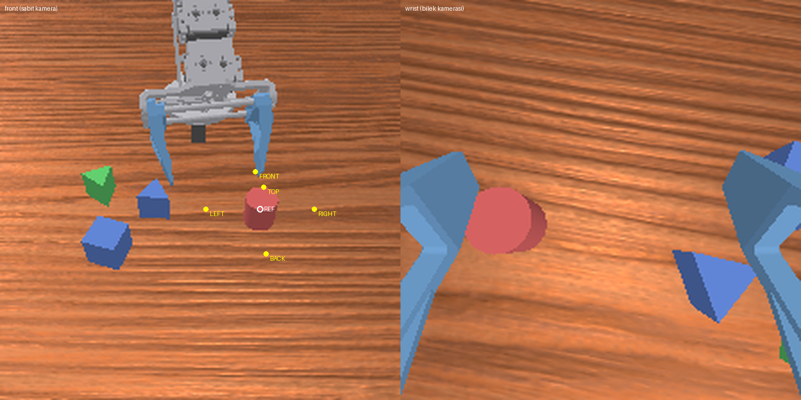

# VLA Görev Tanımları: Çok Şekilli İlişkisel Yerleştirme

Ortam: `MahutKol-MultiShapeRelational-v1` (`src/mahut_kol/envs/multi_shape_task.py`).
Tüm sabitler bu dosyanın başındadır; burada yazan değerler onların açıklamasıdır.

## Koordinatlar ve yönler

- Dünya çerçevesi: masa üstü z = 0, robot tabanı orijinde (z = 0.0558), robot **+x**'e bakar.
- Sabit kamera (`front`) **operatör tarafındadır**: x > 0'da durur, robota (−x yönüne) bakar.
  Bu yüzden **görüntünün sağı = +y**, görüntünün üstü = robota doğru (−x).

| Yön | Hedef (referans merkezine göre) | Görüntüde (front) | İngilizce şablon |
|---|---|---|---|
| FRONT | (x − Δ, y, z) | referansın üstü (robota doğru) | `in front of` |
| BACK | (x + Δ, y, z) | referansın altı (kameraya doğru) | `behind` |
| LEFT | (x, y − Δ, z) | referansın solu | `to the left of` |
| RIGHT | (x, y + Δ, z) | referansın sağı | `to the right of` |
| TOP | (x, y, z + h) | referansın üstünde | `on top of` |

Δ = 0.06 m, h = 0.035 m. FRONT "robota doğru" olarak tanımlıdır: operatör masaya robotun
karşısından bakar, referansın "önü" robotun tarafıdır.

Sarı noktalar referansın (kırmızı silindir) 5 yön hedefidir; görsel
`python3 scripts/render_task_cameras.py --out docs/vla_kameralar.png` ile üretilir ve betik
RIGHT'ın görüntüde LEFT'in sağında, FRONT'un BACK'in üstünde olduğunu doğrular (çıkış kodu 0).

## Komut kuralları

- Manipüle nesne ≠ referans nesne.
- Referans **üçgen prizma** ise **TOP geçersizdir** (sivri tepe): `validate_command` ve
  `reset(options)` açık Türkçe mesajla `ValueError` fırlatır.
- Geçerli kombinasyon sayısı: 9 × 8 × 5 − 24 = **336** (`valid_command_combinations()`).
- Komut verilmeden `reset` çağrılırsa bu 336 kombinasyondan biri bölüm RNG'si ile seçilir.

## Sahne yerleşimi

- Çalışma alanı (nesne merkezleri ve hedefler): x ∈ [0.10, 0.22], y ∈ [−0.16, 0.12] m.
  `scripts/compute_workspace.py` ile FK örnekleme + IK doğrulamasıyla hesaplandı
  (çıktı: `docs/workspace_map.txt`). MahutKol tam aşağı bakarak yalnızca tabana çok yakın
  erişebildiğinden kavrama düşeyden 45–55° eğik yapılır. Kol düzlemi tabandan yanal ≈ −4.4 cm
  kaçık olduğu için alan y'de simetrik değildir.
- Kayıtta 2 distractor (toplam 4 aktif nesne). Aktif olmayanlar z = −10'da park.
- Nesne merkezleri arası ≥ 0.065 m (açık parmaklar nesne merkezinden ~0.058 m'ye uzanır).
- **Hedef boş:** manipüle nesne ve distractor'lar hedef noktasından da ≥ 0.065 m uzakta;
  olmazsa yeniden örneklenir. Referans, hedef çalışma alanında kalacak bölgeden seçilir.
- Başlangıç yaw'ı kavranabilir yönelimde: küp 90°, prizma 120° simetrisiyle tabana göre
  radyal yöne hizalı ± 15° gürültü (`yaw_noise_deg` seçeneği); silindir serbest.

## Başarı kriteri

`success = is_placed ∧ is_released ∧ is_static`

- `is_placed`: hedefe yatay uzaklık < 0.025 m, |Δz| < 0.012 m, nesne dik (≤ 20° eğim).
- `is_released`: parmak eklemleri < 0.022 (0 = açık, 0.042 = kapalı) ve temas kuvveti yok.
- `is_static`: nesne ardışık 3 kontrol adımı boyunca hız < 0.02 m/s ve < 0.5 rad/s.

Tolerans gerekçesi: komşu iki yönün hedefleri arası Δ√2 = 0.085 m; başarı daireleri örtüşmesin
diye yarıçap < 0.042 m. Ayrıca hedefe r uzaktaki nesne referansa en az Δ − r yakındır; iki 35 mm
nesne iç içe geçmesin diye r ≤ 0.025 m. Bu durumda bir nesne yalnızca kendi yönünün ±25°
diliminde başarılı sayılır.

## Kameralar (geçici; donanım netleşince güncellenecek)

| Ad | Konum | Çözünürlük | FOV |
|---|---|---|---|
| `front` | göz (0.46, −0.03, 0.36) → hedef (0.15, −0.03, 0.02) | 224 × 224 | 52° |
| `wrist` | `link_gripper_center`'a monte, TCP çerçevesinde (−0.02, 0, 0.045), 35° aşağı eğik | 224 × 224 | 80° |

Değerler `multi_shape_task.py` başındaki `CAMERA_*`, `FRONT_CAMERA_*`, `WRIST_CAMERA_*`
sabitlerinden tek yerden değiştirilir.

## Süre

`max_episode_steps = 600` (20 Hz'de 30 sn). `gym.make(..., max_episode_steps=N)` ile değişir.
